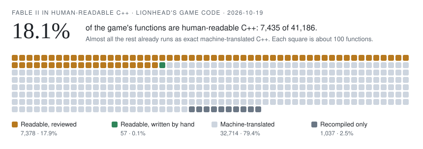

# Fable2RE / Fable2Reimagined

**Fable II rebuilt as human-readable C++ for a fully native PC port, made on your machine from your own Xbox 360 disc.**

Our destination is a readable, maintainable C++ implementation of the entire game: code people can understand, build, modify, and extend. We want players to bring their own disc, produce their own PC build, and preserve the complete original experience while opening it to modern systems, community-operated online services, comprehensive modding, custom quests and levels, and restored Lionhead debug tools.

## Not a recompilation: a reconstruction

**Fable2RE is a source reconstruction of Fable II.** It is a different kind of project from a static recompilation, even though both start from the same tools.

A static recompiler such as [ReXGlue](https://github.com/rexglue/rexglue-sdk) converts the game's PowerPC machine code into C++ automatically, one instruction at a time, and links it with a runtime that recreates the Xbox 360 around it: its registers, its big-endian memory, its console services. The result runs the game. That is how [Himdo's Fable-2-Recomp](https://github.com/himdo/Fable-2-Recomp) works: its README describes guest PowerPC code "statically recompiled to C++ at build time by `rexglue codegen`", with game patches, a launcher, a debug menu and Lua support built around it (checked 2026-10-15). Recompiled code is regenerated from the executable on every build. It is not written to be read, and changing the game means patching around it.

Fable2RE uses a recompiled build only as its starting point: a reference that runs and that every rebuilt function is tested against. The work is to rebuild the game itself:

- **Readable source.** Every function rewritten as C++ a person can read, with real names, types and classes, checked against the original's behaviour before it replaces it, and reviewed.
- **Native PC systems.** The console underneath replaced by PC rendering, audio, input, files and online services, until nothing emulates an Xbox 360.
- **Modding at the source level.** Change the game's own code, plus a native plugin SDK, Lua and data tools, and Lionhead's debug tools restored.

| | Static recompilation | Fable2RE |
|---|---|---|
| The game's code | Generated C++ that mirrors the PowerPC instructions, regenerated at every build | Readable C++ per function, with names, types and classes, kept and reviewed as source |
| What it runs on | A runtime that recreates the Xbox 360 | That runtime today; native PC systems as they replace it |
| Changing the game | Patches and hooks around the generated code | Edit the game's source; plugin SDK, Lua and data tools |
| Progress means | The game runs and can be finished | How much of the game is readable C++ (below) |

This is the path [OpenGOAL](https://opengoal.dev/) took for Jak and Daxter: decompile the game into readable source, run it natively on PC, and have players supply their own disc. Fable2RE takes that path for Fable II, in C++. It is inspired by OpenGOAL and not affiliated with it.

## Progress

How much of the game is human-readable C++ in this repository, counted from its own files and updated with every published change:

<!-- progress:begin (written by tools/progress.py from tracked files: do not edit by hand) -->
<picture>
  <source media="(prefers-color-scheme: dark)" srcset="docs/images/progress-dark.svg">
  
</picture>

| Lionhead's game code | Functions | Share |
|---|---:|---:|
| Readable C++ with every name | 4,072 | 9.9% |
| Readable C++, written by hand | 57 | 0.1% |
| Readable C++, names still to do | 1,421 | 3.5% |
| Rewritten, still at machine level | 1,885 | 4.6% |
| Machine-translated C++, exact and tested | 32,714 | 79.4% |
| Recompiled only | 1,037 | 2.5% |
| **All of Lionhead's functions** | **41,186** | |

Human-readable means readable C++ with every name: no CPU registers in the code, and the function, what it calls, its globals, variables and fields all named (`tools/rewrite/readability.py`). The 7,378 rewritten functions in 249 published modules all pass a strict check against the original and a review; most still need their names, or still work through the CPU registers. 5,232 of the game's functions (12.7%) carry a name in the shared dictionary. By code size, 1.3% of the game is human-readable so far (4,129 functions). Details, every area of the executable and the history: [conversion progress](docs/progress.md). Counted by `tools/progress.py` from the files in this repository, as of 2026-10-19.
<!-- progress:end -->

## Where we are today

**This is an active reverse-engineering and porting project, not a finished native port or a validated one-click release.** The current development target is one Fable II executable on Windows x64: the Game of the Year disc's `default.xex`, media ID `716F0A0D`, SHA-256 `88c4ef2e18e65409444d1b068eff921d1f7e180a5ae64edc64ba6b0872372662`. Run `python tools/xex_info.py <path to default.xex>` to identify your copy. A 100 MiB copy left by an older extract is recognised as an alias: it is the same executable followed by unrelated data. Supporting anyone's Xbox 360 copy is the long-term aim; other executable revisions need their own validation.

The working codebase combines statically recompiled game code, automatically lifted C++, readable replacements, a native D3D12 renderer, and remaining ReXGlue runtime services. Existing research records in-game play, working Lua commands and level loading. Those observations do not establish full-game correctness or complete debug-menu restoration.

| Area | Present work | Intended result |
|---|---|---|
| Game code | Generated baseline, automatic lifting, and readable subsystem replacements | Human-readable C++ for the entire game |
| PC runtime | Native renderer and GPU synchronization; remaining guest-memory and platform dependencies | Native PC subsystems without Xbox 360 emulation or compatibility layers |
| Modding | Lua/data tools, text and tuning overrides, native plugin SDK | Comprehensive modification of gameplay, UI, content, and engine behavior |
| Online | Console services remain part of the architecture to replace | Versioned, testable Fable2RE services for presence, sessions, cooperative play, and mod compatibility |
| Custom content | Early script/data replacement and native plugins | Documented authoring, packaging, and validation for original quests, levels, systems, and assets |
| Lionhead debug tools | Retail menu parsing, Lua bridge, original-menu enablement, replacement debug displays | Restored original menu with every supported command implemented and tested |
| Building from a copy | Experimental ISO-to-build script for the targeted executable | Reproducible, accessible local setup from supported owned copies |

See [current status](docs/status.md) for evidence and limitations, and the [roadmap](docs/roadmap.md) for the remaining work.

## Shared foundations, separate directions

The defining commitment is **whole-game source reconstruction and eventual independence from the Xbox 360 runtime model**. Static recompilation gives us a working reference; it is an intermediate step toward that destination.

**Fable2RE and [Himdo's Fable-2-Recomp](https://github.com/himdo/Fable-2-Recomp) are separate projects using ReXGlue, with distinct development directions.** Sharing that technology does not make Fable2RE a fork of Himdo's project. Our local runtime tree originates from [Fable2Recomp/Fable2Recomp](https://github.com/Fable2Recomp/Fable2Recomp), and we preserve that upstream attribution.

Himdo's project is a ReXGlue recompilation with game patches, a launcher, debug-menu and Lua features, and renderer work (its README, checked 2026-10-15). Fable2RE's defining commitment is whole-game readable C++ reconstruction and progressive replacement of console compatibility layers with native PC systems. That describes our intended destination; our current build still uses ReXGlue services. See [project direction and provenance](docs/project-direction.md) for the distinction between shared tooling, inherited source, and project goals.

## How we work

We combine the team's prior reverse-engineering experience from **FlyX** with advanced current AI models for code analysis, tooling, and implementation. Our intent is to keep evaluating and adopting the most capable models available for the work. Model output is checked against executable behavior, disassembly, memory layouts, and runtime tests; it is not evidence by itself. Contributors do not need a paid model subscription to build or contribute.

## Get started

From a clone of this repository on Windows x64 (prerequisites: [build guide](docs/building.md)):

```powershell
git submodule update --init --recursive
python -m pip install -r tools/requirements.txt
powershell -ExecutionPolicy Bypass -File tools/setup_all.ps1 -Iso "D:\path\to\your Fable II disc image.iso"
```

`setup_all.ps1` identifies your executable, extracts the disc, generates and lifts the code, installs a default `Fable2.toml` and builds `Fable2.exe`. Every step is resumable, and `-Check` ends with an unattended in-game check. Expect several hours on first run, most of it compiling. A fresh clone was set up this way end to end on 2026-10-12, to the title screen ([record](research/findings/2026-10-12-fresh-clone-end-to-end.md)); [current status](docs/status.md) records what else has been verified. Setup also rebuilds the reviewed readable modules from your disc: the repository holds them without the game's text ([promoted code](docs/promoted-code.md)).

- **Clone the complete workspace:** `git clone --recurse-submodules <repository-url>`. For an existing clone, run `git submodule update --init --recursive`.
- **Build the development port:** [build guide](docs/building.md), including setup limitations.
- **Make mods:** [modding guide](docs/making-mods.md).
- **Restore and use debug features:** [debug-menu guide](docs/debug-menu.md).
- **Help reconstruct the game:** [contributing](CONTRIBUTING.md) and [C++ conversion guide](docs/conversion-guide.md).
- **Improve the naming dictionary:** [contributor workflows](docs/contributor-workflows.md) and [naming pipeline](tools/naming/README.md).
- **Work on online or creator architecture:** [online and expansion architecture](docs/online-and-modding-architecture.md).
- **Explore the implementation:** [architecture](docs/architecture.md) and [documentation index](docs/README.md).

## Source and game content

Users supply their own game executable and assets. Extracted content, generated translations, lifted output, and decompiler exports stay local. The intended public distribution contains project-authored code, tooling, documentation, and factual research metadata; it does not bundle Fable II. See [contribution and distribution guidance](CONTRIBUTING.md).

Project-authored tools, metadata, documentation, and examples are available under the [MIT License](LICENSE). Other licences apply where a file or folder says so; preserve them, their notices, and attribution:

- `Fable2Recomp/` originates from [Fable2Recomp/Fable2Recomp](https://github.com/Fable2Recomp/Fable2Recomp) (MIT, Copyright (c) 2025 RyzenDew; [`Fable2Recomp/LICENSE`](Fable2Recomp/LICENSE)). Files there that carry a ReXGlue template header (Copyright (c) 2026 Tom Clay, BSD 3-Clause) keep that licence; its text is ReXGlue's [`LICENSE`](https://github.com/rexglue/rexglue-sdk/blob/main/LICENSE).
- `rexglue-sdk/` is [ReXGlue](https://github.com/rexglue/rexglue-sdk) (BSD 3-Clause; portions from [Xenia](https://github.com/xenia-project/xenia), BSD). [`patches/rexglue-sdk.patch`](patches/README.md) modifies it under the same licence and includes fixes backported from later ReXGlue releases.
- Bundled third-party code: [MinHook](Fable2Recomp/thirdparty/minhook/LICENSE.txt) (BSD 2-Clause) and dlmalloc (Doug Lea, public domain, CC0); `tools/extract-xiso` is the [extract-xiso](https://github.com/XboxDev/extract-xiso) submodule under its own licence.

Fable2RE is an independent community project, not an official Microsoft or Lionhead release. Credit to the Fable2Recomp, ReXGlue, Xenia, and other upstream contributors whose work supports the current implementation.
